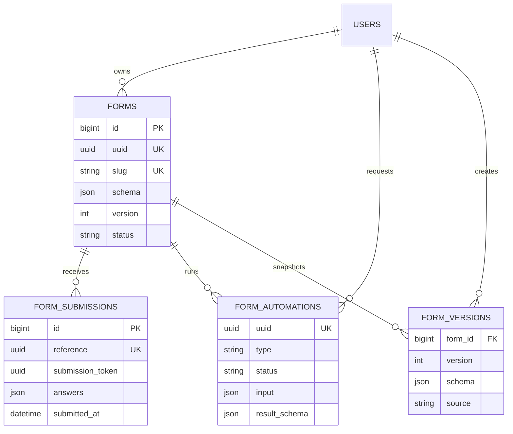

# FormForge - AI-Powered Form Builder

> **Live demo:** Pending deployment hosting credentials. Source is published at [KYogesh-2822/ai-powered-form-builder](https://github.com/KYogesh-2822/ai-powered-form-builder).
>
> **Local demo:** `demo@formforge.test` / `password`

FormForge is a production-oriented form builder built with Laravel 13, React 19, Inertia, Tailwind CSS, MySQL 8, Redis, and Horizon. It supports manual drag-and-drop construction, validated raw JSON editing, queued AI generation and editing, defensive Word/Excel import, public submissions, version rollback, conditional branching, search, and CSV export.

## What is implemented

- 13 field types with click-to-add, drag-and-drop ordering, inline edits, duplication, deletion, sections, and multi-step public forms.
- Per-field keys, defaults, placeholders, help text, required state, choice options, numeric/length/regex/file validation, and conditional display rules.
- One canonical JSON schema shared by the canvas, raw editor, public renderer, server validation, AI output contract, and import mapping.
- Public URLs, schema-derived server validation, private import storage, public upload storage, searchable paginated responses, and streaming CSV export.
- Queued OpenAI generation and edits with visible status, strict Structured Outputs, repair retries, model/token/latency audit data, and no API key exposure.
- Queued DOCX/XLSX parsing with an editable mapping preview and committed sample documents.
- Immutable form versions and rollback, Redis-cached public form payloads, cache invalidation, request throttling, honeypot/timing checks, and idempotent submissions.
- Passkeys, two-factor authentication, email verification, ownership policies, Docker services, Horizon, CI, PHPUnit, PHPStan/Larastan, Pint, ESLint, Prettier, and TypeScript checks.

## Quick start with Docker

Docker is the reference environment because it runs the required MySQL 8.4 and Redis services.

```bash
cp .env.example .env
docker compose up --build -d
docker compose exec app php artisan db:seed
```

Open `http://localhost:8080` and sign in with the demo credentials above. The compose file starts the web application, MySQL 8.4, Redis, Horizon worker, and scheduler. Docker uses the `DOCKER_DB_*` values independently from the native `DB_*` connection, so XAMPP can keep its own MySQL credentials. Its fallback `APP_KEY` is for local Docker use only; set a unique key in every deployed environment.

On a network that performs HTTPS inspection, export its public root certificate in PEM format and set `DOCKER_BUILD_CA_FILE` to that file. The build imports a valid supplied certificate without disabling TLS verification; the included example file is ignored on ordinary networks.

Useful commands:

```bash
docker compose exec app php artisan migrate --force
docker compose exec app php artisan test
docker compose exec app php artisan horizon:status
docker compose logs -f app queue web
```

## Native setup

Requirements: PHP 8.3+, Composer 2, Node.js 22+, MySQL 8, and Redis.

```bash
composer install
npm ci
cp .env.example .env
php artisan key:generate
php artisan migrate --seed
php artisan storage:link
npm run build
```

For development, run `composer run dev`. Alternatively run the Laravel server, Vite, and `php artisan horizon` in separate terminals. If Redis is temporarily unavailable, use `QUEUE_CONNECTION=database`, run `php artisan queue:work --queue=ai,imports,default`, and keep cache/session drivers on supported local stores.

## Important environment variables

| Variable | Purpose |
|---|---|
| `APP_URL`, `APP_KEY` | Canonical URL and encryption key |
| `DB_*` | MySQL 8 connection; defaults target a local `formforge` database |
| `DOCKER_DB_*` | MySQL database and credentials used only by Docker Compose |
| `DOCKER_BUILD_CA_FILE` | Optional PEM root certificate for HTTPS-inspecting networks |
| `REDIS_*` | Cache, session, queue, and Horizon Redis connection |
| `OPENAI_API_KEY` | Server-only OpenAI credential; never commit it |
| `OPENAI_BASE_URL` | Defaults to `https://api.openai.com/v1` |
| `OPENAI_MODEL` | Defaults to `gpt-5.6-luna`; change without code edits |
| `HORIZON_ALLOWED_EMAILS` | Comma-separated production Horizon administrators |
| `FILESYSTEM_DISK` | Public submission-file disk; imports always use the private local disk |

## Architecture

The application remains a modular Laravel monolith. Inertia provides server-directed routing while React owns the builder interactions. Redis/Horizon isolates long-running AI and document work from web requests. Services contain schema normalization, validation compilation, AI contracts, import parsing, caching, and version transitions; controllers remain orchestration boundaries.



### Scale-oriented indexes

- `forms`: unique UUID and slug; `(user_id, status, updated_at)` for owner dashboards; `(status, published_at)` for publishing queries.
- `form_submissions`: unique public reference; `(form_id, submitted_at)` for pagination/export; `(form_id, status)`; global `submitted_at`; unique `(form_id, submission_token)` for idempotency.
- `form_automations`: unique UUID; `(form_id, type, created_at)`, `(status, created_at)`, and `(user_id, created_at)` for worker/admin views.
- `form_versions`: unique `(form_id, version)` and `(form_id, created_at)` for history and rollback.

The migrations are authoritative. [database/schema/mysql-schema.sql](database/schema/mysql-schema.sql) is a reproducible schema-and-demo-data export generated after running every migration and seeder against a MySQL-compatible server.

## Main routes

| Method | Route | Purpose |
|---|---|---|
| `GET/POST` | `/f/{slug}` | Public render and submission |
| `GET/POST/PUT/DELETE` | `/forms...` | Authenticated form management |
| `PATCH` | `/forms/{form}/publish` | Publish or return to draft |
| `POST` | `/forms/{form}/ai` | Queue AI generation/editing |
| `POST` | `/forms/{form}/imports` | Queue private DOCX/XLSX import |
| `POST` | `/form-automations/{automation}/apply` | Apply reviewed import mapping |
| `POST` | `/forms/{form}/versions/{version}/restore` | Restore snapshot as a new version |
| `GET` | `/forms/{form}/submissions` | Paginated, searchable response list |
| `GET` | `/forms/{form}/submissions/export` | Stream CSV without loading all rows |
| `GET` | `/horizon` | Authorized queue operations dashboard |

All builder, automation, history, and response routes require an authenticated, verified owner. Public POSTs are throttled.

## AI prompt and output strategy

The AI integration uses the OpenAI [Responses API](https://platform.openai.com/docs/api-reference/responses) with [Structured Outputs](https://platform.openai.com/docs/guides/structured-outputs):

1. A developer prompt defines the supported field vocabulary, unique snake-case keys, conservative validation, ID preservation for edits, and prohibition of HTML, secrets, or unsupported types.
2. The API receives a strict JSON Schema mirroring the application schema. `store=false` is set, and a one-way HMAC user identifier is supplied as the safety identifier.
3. Returned JSON is decoded and passed through `FormSchema::validateAndNormalize()`. Hallucinated types, duplicate/invalid keys, empty choice options, and malformed shapes are rejected.
4. Validation or decode failures are summarized into a repair note and retried, up to three model attempts; transport retries are separate. Broken output is never written.
5. The queued job records model, input/output tokens, latency, error state, and timestamps. Successful AI edits also create an immutable form version.

The API boundary lives in `app/Services/OpenAiFormGenerator.php`, so replacing the provider or extracting a FastAPI service does not affect controllers or the schema domain.

## Word and Excel imports

Uploads are limited to DOCX/XLSX and 10 MB, stored privately, then processed on the `imports` queue.

- Word Heading styles become sections. Prompt paragraphs become inferred fields. Inline comma/semicolon/pipe choices and list items become options.
- The documented Excel layout requires a `label` column and supports `section`, `type`, `required`, `options`, `placeholder`, `help_text`, and `key` columns.
- A plain spreadsheet is also accepted: every populated cell in its first row becomes a field label.
- The deterministic parser handles explicit structure; the editable preview lets the user correct ambiguous types before applying. AI is deliberately not required for deterministic imports.

Tested binaries and their generator are in [docs/samples](docs/samples). Unknown structures fail with a visible automation error instead of silently producing a broken form.

## Quality checks

```bash
composer lint:check
vendor/bin/phpstan analyse --memory-limit=512M
php artisan test
npm run lint:check
npm run format:check
npm run types:check
npm run build
```

The CI workflow runs the same checks for pushes and pull requests. Tests use isolated in-memory SQLite for speed, while migrations have also been exercised against a MySQL-compatible server and the deployment stack pins MySQL 8.4.

## Deployment

For production, provide HTTPS, a unique `APP_KEY`, managed MySQL/Redis, durable private/public storage, a real mail transport, `APP_ENV=production`, `APP_DEBUG=false`, Horizon supervision, scheduler execution, and the correct `HORIZON_ALLOWED_EMAILS`. Run migrations as a release step, then use `php artisan horizon:terminate` for zero-downtime worker reloads.

The requested live deployment cannot be completed until the owner supplies the Git origin and hosting access. No repository, branch owner, or destination has been assumed.

## Known limitations

- AI tests mock the provider contract; a live call requires the deployer's API key and account quota.
- Word parsing targets semantic headings, prompt paragraphs, and common list structures, not arbitrary visual layouts, OCR, legacy `.doc`, macros, or embedded scans.
- File validation covers extension, MIME, and size; a production handling sensitive uploads should add malware scanning and object-storage lifecycle rules.
- The history panel shows the latest 15 snapshots. Older versions remain stored but do not yet have a dedicated paginated screen.
- Conditional logic currently supports equals, not-equals, and contains. Nested boolean groups and whole-section branching are future work.

See [DECISIONS.md](DECISIONS.md) for assumptions, Part D choices, trade-offs, and the two-week roadmap. Original assignment files are retained under `docs/reference`.
